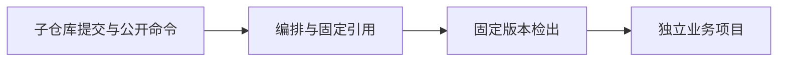

# FST-001 前后端联合模板设计

本设计落实 2026-11-23 会话已确认方案：三个模板独立组合、个人仓库迁移、统一 UI 包、新项目不承担历史兼容或 shadcn 上游一致性。

## 用户目标

通过固定 Git submodule 引用独立前端与后端模板，提供一套安装、环境配置、数据库准备、开发、契约生成、验证和项目初始化流程。

## 业务术语

模板指可以独立安装并用于初始化新项目的仓库；集成环境用于公共能力开发与验证；公开入口是各仓库声明的导出或命令契约。

## 业务角色与权限

仓库维护者在个人仓库权限内维护和发布版本；应用开发者安装固定版本并初始化自己的项目。组织来源只读，集成模块不承担实际应用用户的认证或资源授权。

## 前置条件

不适用。配置、依赖可用性及外部输入在各自责任边界处理，不用前置条件掩盖当前模块的校验职责。

## 业务输入与输出

bun run setup 初始化固定子模块、按锁文件分别安装、从示例创建缺失的本地配置但不覆盖已有值；bun run dev 同时启动两端；bun run generate:web 从 Server 导出 OpenAPI 再调用前端生成器；bun run check 执行自身文档与两端检查；bun run build 构建前端。bun run create -- <新目录> 将已锁定模板展开为普通源码并创建新 Git 仓库，不携带子仓库 Git 信息、凭据、node_modules 或构建缓存；目标已存在时失败，不覆盖。

## 正常业务流程

开发者安装固定版本，配置示例中声明的外部依赖，运行开发入口并按公开契约扩展应用；维护者完成文档、源码和产物验证后发布新版本。

## 业务规则与状态变化

bun run setup 初始化固定子模块、按锁文件分别安装、从示例创建缺失的本地配置但不覆盖已有值；bun run dev 同时启动两端；bun run generate:web 从 Server 导出 OpenAPI 再调用前端生成器；bun run check 执行自身文档与两端检查；bun run build 构建前端。bun run create -- <新目录> 将已锁定模板展开为普通源码并创建新 Git 仓库，不携带子仓库 Git 信息、凭据、node_modules 或构建缓存；目标已存在时失败，不覆盖。

## 业务边界

本仓库只编排子仓库公开命令和固定版本，不获取或保存应用用户数据，也不承担应用的身份认证或资源授权。外部服务验收结果由所属模板记录。

## 业务异常情况

命令参数无效、依赖命令失败、验证未通过或远端权限不足时，CLI 返回非零，不继续标记步骤成功；失败不改写来源组织仓库，已完成的提交与发布保持可追溯，不能伪造后续步骤成功。

## 架构与技术约束

联合模板只承载编排，不复制前端/后端业务实现，不覆盖子仓库源文件。packages/web 指向 Preyou/ngt-starter，packages/server 指向 Preyou/yuumi-server，均固定提交。各自独立安装依赖，不启用根 Bun workspaces。提供开发 PostgreSQL 与 Redis compose，Logto 使用用户配置的服务。

## 环境初始化约定

setup 消费 Server 已定义的环境示例，默认示例不提供数据库名、连接串或密钥；使用者为新项目配置独立存储后运行迁移和开发。已有本地配置仍不覆盖。自带 Compose 是可选的隔离开发环境，不替换默认示例中记录的当前服务器地址；选择 Compose 时由使用者显式填写该环境的连接信息。

## 模块职责与依赖

当前文档只约束本仓库模块。其他仓库通过其公开契约协作，不访问其内部状态；接口类型以服务端 OpenAPI 为权威，应用状态由使用方所有，通用机制由公共库所有。

## 数据来源与流向

| 数据          | 权威来源                    | 责任与方向                              | 生命周期/一致性                                   |
| ------------- | --------------------------- | --------------------------------------- | ------------------------------------------------- |
| 源码版本      | 各子仓库 Git 提交与稳定标签 | 子仓库维护，父仓库通过 gitlink 固定消费 | 子仓库先提交发布，父仓库再更新，不能静默跟随 main |
| 安装/运行结果 | 子仓库公开命令的退出码      | 编排模块发起并读取，失败中断后续阶段    | 当前命令实例结束后清理子进程                      |
| 本地配置      | 使用者文件；缺失时来自示例  | setup 只创建缺失文件，不覆盖            | 真实配置不进入版本控制或新项目复制                |
| 展开项目      | 已锁定模板的受版本控制文件  | create 命令写入新的目标目录             | 排除 Git、凭据、缓存；已有目录不覆盖              |

## 代码行为要求

根脚本在所属子项目目录执行公开 Bun 命令，子进程失败返回非零；dev 任一进程退出时清理另一进程。compose 仅使用模板专用服务/命名卷和可配置宿主端口，不触碰 Storyworld 数据。创建项目从联合模板 HEAD 和其中两个固定的子模块提交读取文件。工作区与暂存内容不参与展开。两端须初始化到该提交所记录的固定版本；未初始化、固定提交不一致或从已展开的业务目录再次调用时，返回非零且不创建目标目录。`.env.example`、前端公开的 `env/.env` 和各仓库的 bun.lock 随新项目提交，私有配置与 Git 元数据排除。新 Git 仓库由用户指定发布目标。

## 范围取舍与非目标

不建立历史包名或旧导入兼容层；不要求与 shadcn 上游结构、API 或行为保持一致。保留可访问性、项目内主题和明确的模块契约。业务功能不进入公共库。

## 明确禁止的业务行为

禁止向组织源仓库推送或改写其引用；禁止复制真实凭据和业务数据进入模板；禁止用默认成功结果吞掉失败。违反时本次操作失败且不发布新版本。

## 验收条件

bun run docs:check；bun run check；bun run build；全新目录 setup；固定子模块克隆；隔离 compose 数据库 migration；create 展开目录审计、提交后重新克隆、冻结安装与构建；未初始化、引用不匹配和预先存在目录均失败且不改数据。

## 联合开发约定

`AUTH_MODE` 由服务端环境确定。新建项目默认关闭登录。在关闭、自建或 Logto 待配置时，`dev:local` 分配项目专属 localhost 子域和可用端口。配置完整的 Logto 使用已登记回调的 `APP_ORIGIN`，本地编排只绑定回环接口。已登记端口不空闲时，启动非零退出，保留用户文件和数据。

`dev:local` 启动隔离的 PostgreSQL 和 Redis，运行迁移并确认前端代理就绪。重跑复用原项目的 Compose 数据卷。`auth:user:local` 接入运行中的项目数据库，普通 `auth:user` 使用 Server 配置的数据库。两条命令依赖 Server 的账号管理入口，由标准输入传递密码。

普通开发和生产运行均复用 Web 提供的同源 API 代理。组合项目提供同时运行前后端的入口，也可以在后端独立运行时只启动 Web。模板展开随固定 Web 提交包含生产代理配置。
