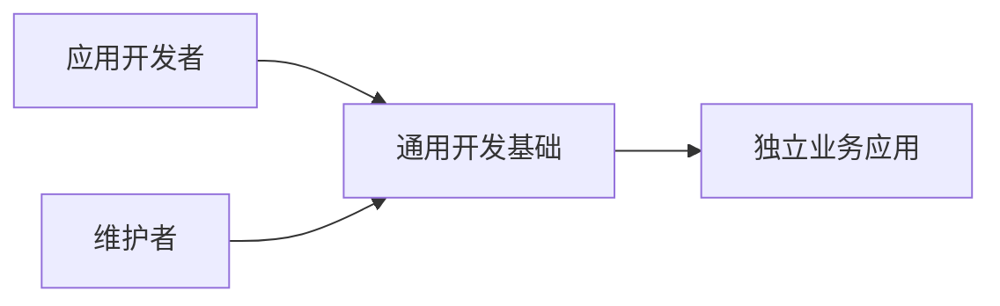

# OD-001 前后端联合模板

## 目标

组合独立前端与后端模板，提供一致的初始化、开发、验证和项目创建流程，使开发者能够得到自己的完整应用。

## 产品边界

服务应用开发者和公共能力维护者。个人项目独立演进，组织来源保持原样。源业务的数据与生产配置不作为模板内容。

## 模块与能力

| 能力           | 状态   | 详细设计                                 |
| -------------- | ------ | ---------------------------------------- |
| 前后端联合模板 | 已规划 | [FST-001](../detailed-design/fst-001.md) |

## 当前范围之外

不交付 Storyworld 的角色、剧本、AI 模型管理或对象存储业务。历史版本兼容与 shadcn 上游一致性不形成产品承诺。

建项输入是当前联合模板提交与其固定的子模板提交。生成项目交付公开配置和锁文件，支持从新的 Git 检出继续安装。

## 废弃说明

不适用，本文件描述新项目的有效目标。

## 联合开发配置

dev:local 启动隔离的 PostgreSQL 和 Redis，等待迁移和前端代理就绪。启动器继承服务端登录模式，使默认开发地址和已登记的 Logto 回调协调。自建账号由 Server 的公开命令创建。业务项目自己决定访问规则和账号数据。

生成的应用在开发和部署时使用统一入口访问前端及后端，前后端可以独立部署。
